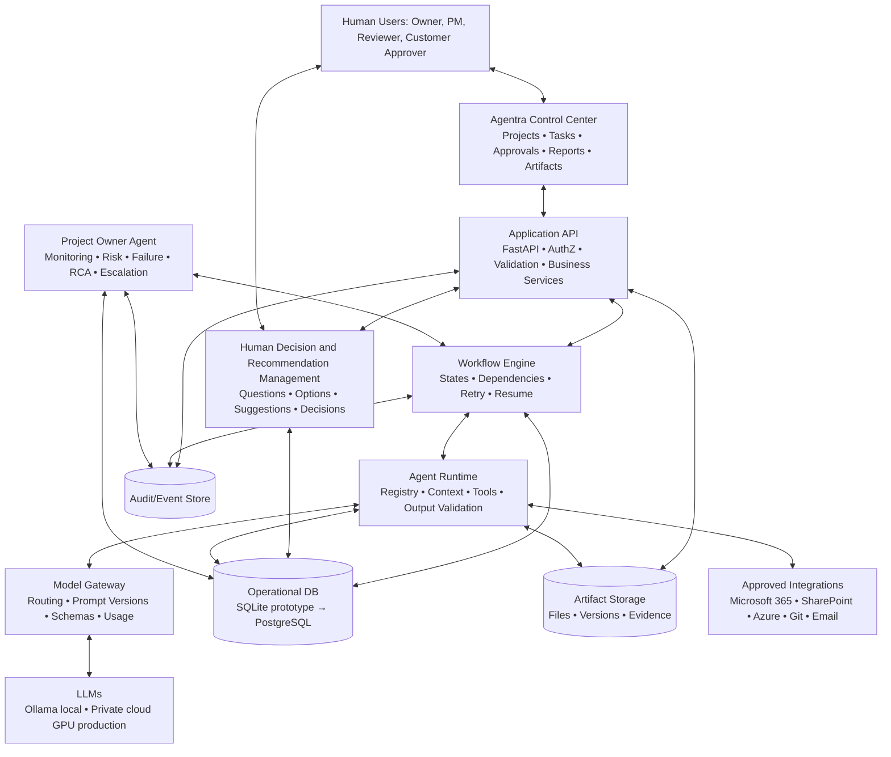
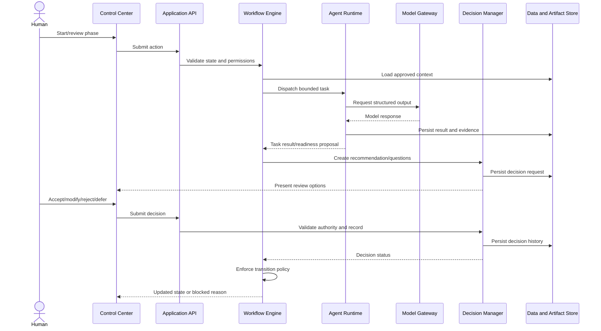

# Agentra — Product Overview and Technical Architecture

**Tagline:** A Company Runs by Agents  
**Initial market:** UAE, then international  
**Initial services:** SharePoint, Power Platform, Azure and AI  
**Initial target:** Small and medium-sized businesses

## 1. Executive overview

Agentra is an AI-native IT services company operating system. Specialized agents execute business and project-delivery activities through governed workflows. Humans provide strategic direction, customer relationships, approvals and exception handling.

Agentra is not a chatbot collection. It combines:
- **Agents** that perform defined work using approved context and tools.
- **Workflow engine** that controls process state, dependencies and transitions.
- **Human Decision Management** that captures recommendations, questions, suggestions and approvals.
- **Project Owner Agent** that monitors delivery, exceptions and corrective actions.
- **Artifact and evidence services** that preserve versions, traceability and approvals.
- **Reporting** grounded in persisted operational records.

## 2. Vision and business model

The vision is to operate the lifecycle of an IT services business—from lead qualification and discovery through requirements, architecture, implementation, QA, customer acceptance, production and closure—with agents coordinating routine work and humans retaining authority over consequential decisions.

Initial services include SharePoint migration, intranet development and modernization, Power Platform automation/application development, Azure and AI solutions. The business model includes project delivery, modernization, automation, AI solutions and later managed services.

## 3. Product principles

1. Workflow before autonomy.
2. Evidence before status.
3. Human authority for consequential decisions.
4. Recommendations are not decisions or approvals.
5. Separation of duties for independent review.
6. Approvals bind to exact artifact versions.
7. Durable, recoverable workflow state.
8. Least-privilege agent and integration permissions.
9. Provider-neutral model gateway.
10. Modular monolith before microservices.

## 4. Product scope

### MVP — Phases 7–11
| Phase | Name | Outcome |
|---|---|---|
| 7 | Business Analysis and Requirements | Approved requirements baseline |
| 8 | Solution Architecture and Technical Design | Approved design baseline |
| 9 | Development and Implementation | Implemented solution and build evidence |
| 10 | Quality Assurance and Testing | Evidence-backed QA result |
| 11 | Customer UAT and Sign-Off | Customer acceptance/rejection tied to exact version |

### Full product — Phases 1–6, 12–13
| Phase | Name | Outcome |
|---|---|---|
| 1 | Sales and Lead Generation | Qualified opportunities |
| 2 | Meeting Scheduling and Customer Discovery | Validated discovery record |
| 3 | Technical and Commercial Proposal | Reviewed proposal and estimate |
| 4 | Customer Presentation and Negotiation | Negotiation history and agreed proposal |
| 5 | Project Award and PO Validation | Validated award and commercial authorization |
| 6 | Project Kickoff and Governance | Approved project and delivery baseline |
| 12 | Production Go-Live | Authorized deployment and handover |
| 13 | Project Closure | Closure report and accepted handover |

The MVP starts at Phase 7 to validate delivery execution before building sales and commercial automation.

## 5. Standard phase operating cycle

1. Workflow engine validates entry conditions.
2. Phase coordinator creates tasks and assembles approved context.
3. Agent performs bounded work.
4. Runtime validates structured output and persists evidence.
5. Agent presents findings, recommendations, alternatives, rationale, assumptions, risks and questions.
6. Human accepts, rejects, modifies, defers or adds an independent suggestion.
7. Agent incorporates approved decisions into a new artifact version.
8. Authorized reviewer approves/rejects the exact version.
9. Agent assesses readiness and recommends the next phase.
10. Workflow engine independently validates whether transition is permitted.

Readiness states: **Ready**, **Ready with conditions**, **Not ready**, **Blocked**. Human transition choices: proceed, proceed with conditions, return for changes or hold. The workflow engine enforces mandatory conditions.

## 6. Universal Human-in-the-Loop framework

This applies to **all 13 phases**.

Every phase agent must:
- Explain findings and supporting evidence.
- Present a recommendation and meaningful alternatives.
- Explain rationale, assumptions, risks and trade-offs.
- Ask clarification questions.
- Identify decisions requiring human authority.
- Invite human corrections and independent suggestions.
- Recommend the next phase with readiness evidence.

Humans must be able to accept, reject, modify, defer, request changes, add suggestions, select another option/technology/approach, add comments and attach evidence.

The system preserves the original AI recommendation separately from human input and the final decision. Decision records include project, phase, task, recommendation, alternatives, rationale, human contribution, final outcome, actor, timestamp, artifact/version and status. An AI recommendation is never an approval.

**Example:** The BA agent may recommend SharePoint Online, SharePoint Subscription Edition or hybrid. It explains trade-offs and asks for a decision. A human may choose “Other” and specify a custom technology or approach. The requirements baseline is updated only after the authorized decision.

## 7. System architecture

### Logical architecture



### Runtime sequence



### Logical layers
1. **Control Center:** dashboard, projects, tasks, agent status, decision inbox, artifacts and reports.
2. **Application API:** FastAPI, authentication/authorization integration, validation and business services.
3. **Workflow Engine:** state machine, dependencies, dispatch, durable state, retry, timeout, escalation and resume.
4. **Agent Runtime:** registry, context assembly, tool permissions, output validation and execution logs.
5. **Human Decision Management:** recommendations, questions, suggestions, approvals and version binding.
6. **Data/Artifact Services:** operational records, artifact versions, evidence, traceability and audit.
7. **Model Gateway:** provider abstraction, prompt/schema versions, timeout, usage and cost telemetry.

### Module boundaries
`identity`, `projects`, `workflow`, `agents`, `decisions`, `artifacts`, `reporting`, `oversight`, `integrations`, `model_gateway`, `audit`.

## 8. Recommended technology

### Local development
- Python and FastAPI.
- HTML/CSS/JavaScript initial UI; keep API boundary clean.
- SQLite prototype with migrations and repository abstraction for PostgreSQL migration.
- Ollama local model gateway integration; current local model: `qwen3:4b-instruct`.
- pytest, Git and private GitHub.
- Markdown specifications and Mermaid diagrams.

### Production direction
Cloud-hosted application/workflow services, PostgreSQL, durable queue as needed, object storage, private cloud GPU inference behind authenticated model gateway, secrets management, tenant isolation, monitoring, backups, audit retention, least privilege and isolated agent execution. vLLM is a candidate production inference server.

Do not require Docker for the first iteration. Do not stop or modify existing Docker/Ollama services or unrelated projects. Do not modify the separate Saha project, its files, database, ports or configuration.

## 9. Security, governance and reliability
- Backend-enforced authorization and project/customer boundaries.
- Scoped credentials, tool allowlists, timeouts and execution isolation.
- Secrets outside source code and prompts.
- Audit decisions, approvals, state transitions, tool actions and agent executions.
- Treat retrieved/uploaded content as untrusted data.
- Idempotency for external side effects; bounded retries.
- Persist workflow state before/after critical steps.
- Support pause, resume, cancellation and escalation.
- No self-approval by agents where independent review is required.
- No fabricated customer sign-off or production authorization.
- Customer data segregation and sanitized knowledge reuse.

## 10. Project Owner Agent

In MVP, monitors Phases 7–11; in full product, all phases. It detects failed/stuck tasks, overdue decisions, repeated retries and scope/schedule/cost/quality risks. It records failures, classifies impact, recommends safe retry or escalation, produces evidence-based RCA, assigns corrective actions and verifies closure. It cannot bypass gates, invent evidence or exceed permissions.

## 11. Reporting

Every phase produces:
- **Executive summary:** status, progress, decisions, blockers, risks and next actions.
- **Detailed report:** inputs, tasks, agent activity, artifact versions, evidence, traceability, reviews, defects, approvals, failures, RCA and decisions.

Reports are grounded in persisted records. AI may summarize but must not invent dates, metrics, completion or approvals.

## 12. Suggested repository structure

```text
agentra/
├── README.md
├── docs/
│   ├── product-overview.md
│   ├── development-guide.md
│   ├── phases/
│   └── cross-cutting/
├── app/
│   ├── api/
│   ├── modules/
│   ├── agents/
│   ├── workflow/
│   ├── model_gateway/
│   └── infrastructure/
├── tests/
├── migrations/
└── scripts/
```

## 13. Development roadmap
1. Confirm architecture and module boundaries.
2. Set up repository, configuration, logging, migrations and tests.
3. Implement project, phase, task, agent execution, artifact, decision, approval and audit entities.
4. Implement workflow state machine and backend transition policy.
5. Implement Human Decision Management.
6. Build Phase 7, then 8, 9, 10 and 11.
7. Add Project Owner monitoring, RCA and corrective-action verification.
8. Add executive and detailed reporting.
9. Test failure, retry, resume, permission denial, version mismatch, approval bypass and traceability.
10. Validate end-to-end MVP with synthetic data.
11. Only after MVP acceptance, add Phases 1–6 and 12–13.

## 14. MVP definition of done
A synthetic project can complete Phases 7–11 with durable workflow state, controlled agents/tools, human review in every phase, immutable decision history, versioned artifacts, backend-enforced gates, QA defect loop, customer UAT sign-off tied to exact version, oversight/RCA, reports and automated tests for success and failure paths.

## 15. Instructions for Claude Code
Treat this pack as the product baseline. Read the overview, development guide, relevant cross-cutting files and target phase spec. Inspect the repository before changes. Propose a plan and tests first. Implement one phase/vertical slice at a time. Never bypass approval, audit, versioning or authorization. Ask before destructive actions, external customer communications, production deployment or paid services.
