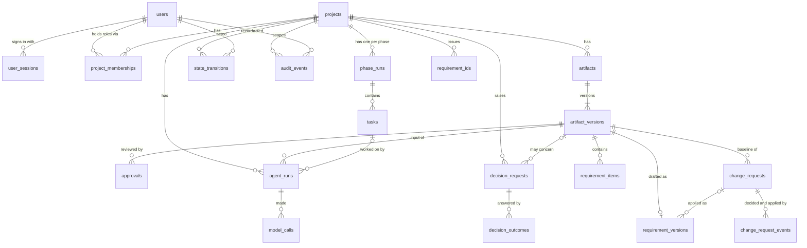

# Data model

PostgreSQL tables as of migration `0006`. Each table belongs to one module. Other modules use that module's `service.py` and never query its tables. Foreign keys across modules exist only for referential integrity.

| Table | Module | Purpose | Key rules |
|---|---|---|---|
| `users` | identity | People, agent service accounts, the system account | `kind` is human, agent or system. Only humans have a password hash; only agents have an `agent_key` (both enforced by CHECK constraints). The system account (`00000000-...-0001`) is seeded by the migration and cannot sign in. |
| `user_sessions` | identity | Login sessions | Only the SHA-256 of the session token is stored. Sessions expire (12 h by default) and are revoked on logout. |
| `project_memberships` | identity | Roles per project | Roles: owner, project_manager, reviewer, customer_approver, agent. Agents may only hold `agent`; people may not hold `agent`. |
| `projects` | projects | Delivery project | `code` is unique. |
| `phase_runs` | workflow | One per project and phase (7-11) | `state` follows `config/workflows/lifecycles/standard_phase.yaml`. `version` is an optimistic lock. Records the definition key and version it was opened with. |
| `tasks` | workflow | Work items inside a phase run | Copied from the phase definition when the project opens (`position`, `depends_on`), so later config edits do not rewrite history. |
| `state_transitions` | workflow | Every phase or task state change | Actor, reason, from and to state, timestamp, and a `seq` that orders changes made in the same instant. Written in the same transaction as the change. |
| `audit_events` | audit | Append-only, hash-chained trail | `hash = sha256(prev_hash + event fields)`. A database trigger refuses UPDATE, DELETE and TRUNCATE. Writers take an advisory lock so the chain never forks. |
| `artifacts` | artifacts | A document of a type from `approval_matrix.yaml` | `(project, type, title)` is unique. `current_version_no` moves only by compare-and-set. |
| `artifact_versions` | artifacts | One immutable version | Content lives in the content-addressed store under its SHA-256 and is re-hashed on every read. **Append-only** (trigger). |
| `approvals` | decisions | Approve, reject or request changes | Bound to `artifact_version_id` plus `content_sha256`, and only for the current version. Only people with a role listed for the type, and (for independent review) never an author of any version. **Append-only**; the latest by `seq` counts. |
| `decision_requests` | decisions | A question, its options and the recommendation | Never edited after it is raised, so the AI's recommendation is always preserved. **Append-only**. |
| `decision_outcomes` | decisions | Each human response: accept, select an option, other, modify, reject or defer | Numbered per request, with a unique `(request, outcome_no)` so concurrent answers cannot both win. A final outcome closes the request. **Append-only**. |
| `agent_runs` | executions | One request for an agent task on one document version | `queued`, `running`, then `succeeded`, `failed` or `blocked`, with error code, message and guardrail findings. Unique `idempotency_key` per (agent, task, version, attempt number): asking again returns the active run. Records the agent, prompt and schema versions, cost and the ids of the decisions it raised. `task_id` links the workflow task it works on; `input_refs` fixes the other documents and decision states it read. |
| `model_calls` | executions | Every model call, and the spend ledger for the monthly cap | Written as `pending` at its worst-case cost **before** the call and committed, then settled with real tokens, cost, the model that answered, fallback use, stop reason, refusal category, latency and request id. Pending or abandoned calls keep counting at their reserve. Budget checks take an advisory lock. |
| `requirement_versions` | requirements | One drafted requirements set, tied to one requirements baseline document version | Summary, process flow, set-level quality flags, inputs, the previous version (for added and removed IDs), the answers to review comments and the change request it applied, if any. **Append-only**. |
| `requirement_items` | requirements | Each requirement, story, rule, assumption, dependency or open question in a version | Item ID, kind, label (fact, assumption, suggestion, open question), status derived in code, priority, acceptance criteria, resolved sources (document version and quote, or decision and answer), links to the items it traces to (`related`) and quality flags. **Append-only**: a revision is a new version with a full new set. |
| `change_requests` | requirements | A request to change an approved baseline version, exactly as raised | Number (CR-001), reason, change, impact, affected item IDs (which must exist in that baseline), whether new items are allowed, who raised it. **Append-only**. |
| `change_request_events` | requirements | Each approval or rejection, in a role, and the version that applied it | One decision per role, one application per request (partial unique indexes). Status is derived: rejected if any rejection, approved when every required role approved, applied once a version applied it. **Append-only**. |
| `requirement_ids` | requirements | The item IDs a project has issued | Unique per project; numbers are never reused, so an ID means the same requirement in every version. **Append-only**. |
| `jobs` | infrastructure | Background job queue | One job per `idempotency_key`. Claimed with `FOR UPDATE SKIP LOCKED` under a lease; reclaimed when the lease expires; `dead` after `max_attempts`. |
| `outbox_messages` | infrastructure | External side effects | Written in the same transaction as the change that causes them. Delivered at least once, and handlers receive the idempotency key. |

## How a state change is recorded

`WorkflowService._apply` runs these steps in order, inside the caller's transaction:

1. **Access:** the actor must be able to see the project. Otherwise the answer is 404, so the project's existence is not revealed.
2. **Freshness:** `expected_version` must equal the current version, otherwise 409.
3. **Lifecycle and role:** the transition must exist in the lifecycle YAML, and the actor must hold one of its roles.
4. **Gates:** entry (earlier phases completed), exit (all tasks closed, and every artifact of each type in `exit.required_approvals` approved at its current version with intact content), task start (phase in progress, dependencies completed).
5. **Update:** compare-and-set `UPDATE ... WHERE version = expected`. If no row matches, the answer is 409, which catches races that step 2 cannot.
6. **Record:** a `state_transitions` row and an `audit_events` row (before and after state and version, reason, actor).

## Planned additions

- Increment 3c: reports (requirements summary and detailed BRD/traceability), incident records for failed agent runs.
- Later: evals, tool calls.
