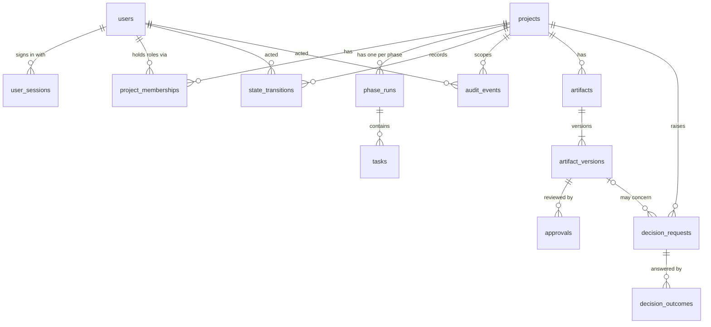

# Data model

PostgreSQL tables as of migration `0003`. Each table belongs to one module. Other modules use that module's `service.py` and never query its tables. Foreign keys across modules exist only for referential integrity.

| Table | Module | Purpose | Key rules |
|---|---|---|---|
| `users` | identity | People, agent service accounts, the system account | `kind` is human, agent or system. Only humans have a password hash; only agents have an `agent_key` (both enforced by CHECK constraints). The system account (`00000000-...-0001`) is seeded by the migration and cannot sign in. |
| `user_sessions` | identity | Login sessions | Only the SHA-256 of the session token is stored. Sessions expire (12 h by default) and are revoked on logout. |
| `project_memberships` | identity | Roles per project | Roles: owner, project_manager, reviewer, customer_approver, agent. Agents may only hold `agent`; people may not hold `agent`. |
| `projects` | projects | Delivery project | `code` is unique. |
| `phase_runs` | workflow | One per project and phase (7-11) | `state` follows `config/workflows/lifecycles/standard_phase.yaml`. `version` is an optimistic lock. Records the definition key and version it was opened with. |
| `tasks` | workflow | Work items inside a phase run | Copied from the phase definition when the project opens (`position`, `depends_on`), so later config edits do not rewrite history. |
| `state_transitions` | workflow | Every phase or task state change | Actor, reason, from and to state, timestamp. Written in the same transaction as the change. |
| `audit_events` | audit | Append-only, hash-chained trail | `hash = sha256(prev_hash + event fields)`. A database trigger refuses UPDATE, DELETE and TRUNCATE. Writers take an advisory lock so the chain never forks. |
| `artifacts` | artifacts | A document of a type from `approval_matrix.yaml` | `(project, type, title)` is unique. `current_version_no` moves only by compare-and-set. |
| `artifact_versions` | artifacts | One immutable version | Content lives in the content-addressed store under its SHA-256 and is re-hashed on every read. **Append-only** (trigger). |
| `approvals` | decisions | Approve, reject or request changes | Bound to `artifact_version_id` plus `content_sha256`, and only for the current version. Only people with a role listed for the type, and (for independent review) never an author of any version. **Append-only**; the latest by `seq` counts. |
| `decision_requests` | decisions | A question, its options and the recommendation | Never edited after it is raised, so the AI's recommendation is always preserved. **Append-only**. |
| `decision_outcomes` | decisions | Each human response: accept, select an option, other, modify, reject or defer | Numbered per request, with a unique `(request, outcome_no)` so concurrent answers cannot both win. A final outcome closes the request. **Append-only**. |
| `jobs` | infrastructure | Background job queue | One job per `idempotency_key`. Claimed with `FOR UPDATE SKIP LOCKED` under a lease; reclaimed when the lease expires; `dead` after `max_attempts`. |
| `outbox_messages` | infrastructure | External side effects | Written in the same transaction as the change that causes them. Delivered at least once, and handlers receive the idempotency key. |

## How a state change is recorded

`WorkflowService._apply` runs these steps in order, inside the caller's transaction:

1. **Access:** the actor must be able to see the project. Otherwise the answer is 404, so the project's existence is not revealed.
2. **Freshness:** `expected_version` must equal the current version, otherwise 409.
3. **Lifecycle and role:** the transition must exist in the lifecycle YAML, and the actor must hold one of its roles.
4. **Gates:** entry (earlier phases completed), exit (all tasks closed, and every artifact of each type in `exit.required_approvals` approved at its current version with intact content), task start (phase in progress, dependencies completed).
5. **Update:** compare-and-set `UPDATE ... WHERE version = expected`. If no row matches, the answer is 409, which catches races that step 2 cannot.
6. **Record:** a `state_transitions` row and an `audit_events` row (before and after state and version, reason, actor).

## Planned additions

- Increment 2: agent runs and incidents.
- Increment 3: requirement items, traceability, change requests against an approved baseline.
